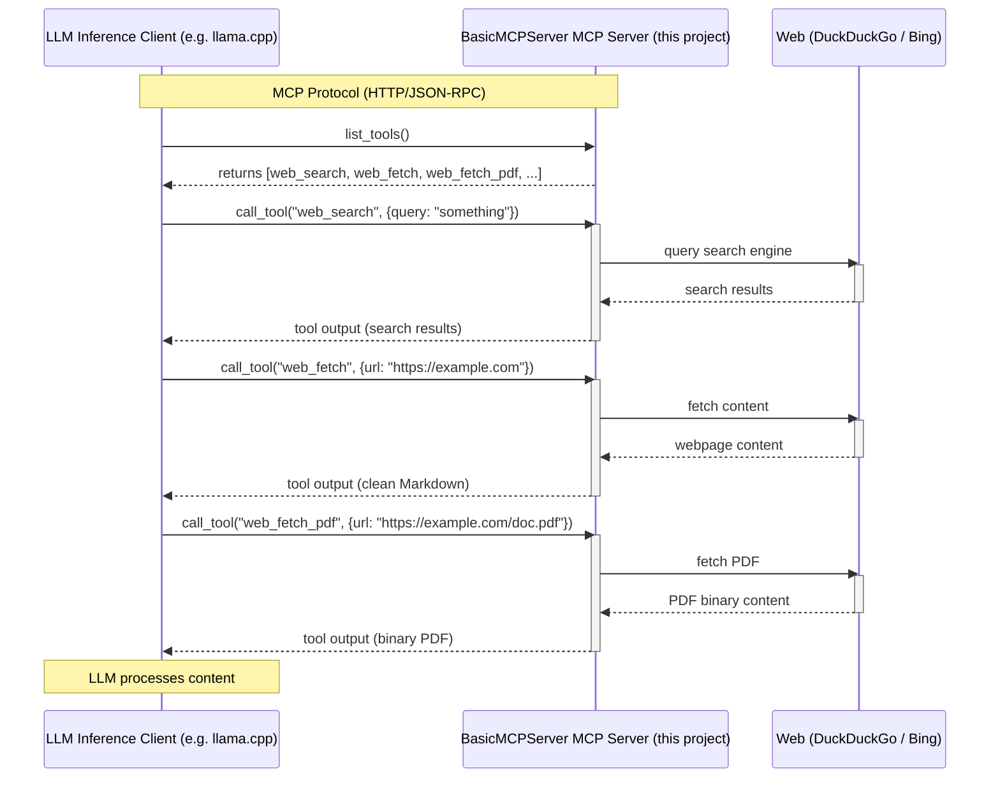

# BasicMCPServer: Minimal MCP Server



A minimal MCP (Model Context Protocol) server that provides web search and web fetching capabilities.


## Features

- **Web Search**: Search the web using DuckDuckGo or Bing and retrieve titles, URLs, and snippets.
- **Web Fetch**: Fetch a webpage and extract its main content as clean Markdown using Trafilatura.
- **Web Fetch PDF**: Fetch a PDF file from a URL and return its binary content unaltered using httpx.


## Installation

Ensure you have Python 3.12+ and `uv` installed.

```bash
uv sync
```


## Running the server

```bash
uv run python main.py
```

The server will be available via HTTP at `http://localhost:8000/mcp`. If running in a container, use `http://<host>:8000/mcp`.


## Running tests

```bash
uv run python -m pytest
```

### Integration Tests
We have integration tests that verify the actual web search and web fetch capabilities:

- `tests/test_integration.py`
    - `test_ddgs_direct_integration`: Verifies that the `ddgs` library performs actual web searches.
    - `test_web_search_ddg_tool_integration`: Verifies the `web_search_ddg` MCP tool correctly integrates with DuckDuckGo.
    - `test_web_search_bing_tool_integration`: Verifies the `web_search_bing` MCP tool correctly integrates with Bing.
    - `test_web_fetch_direct`: Verifies that `web_fetch` can successfully fetch and parse a real webpage.
    - `test_web_fetch_tool_integration`: Verifies the `web_fetch` MCP tool correctly integrates with `trafilatura`.
    - `test_web_fetch_pdf_direct`: Verifies that `web_fetch_pdf` can successfully fetch a PDF file.
    - `test_web_fetch_pdf_tool_integration`: Verifies the `web_fetch_pdf` MCP tool correctly integrates with `httpx`.

Run integration tests specifically:
```bash
uv run python -m pytest tests/test_integration.py
```

## Test Suite

The project includes a comprehensive test suite organized across three test files:

### Test Files Overview

| Test File | Purpose | Test Count |
|-----------|---------|------------|
| `tests/test_main.py` | Unit tests for individual tool functions with mocked dependencies | 9 |
| `tests/test_mcp_tools.py` | Tests for MCP tool registration and metadata | 1 |
| `tests/test_integration.py` | Integration tests with real external services | 7 |

### Detailed Test List

#### tests/test_main.py (Unit Tests)

| Test Name | Description | Mocked Dependency |
|-----------|-------------|------------------|
| `test_web_search_success` | Verifies successful web search with mocked DDGS | DDGS |
| `test_web_search_empty` | Verifies handling of empty search results | DDGS |
| `test_web_fetch_success` | Verifies successful webpage content extraction | trafilatura |
| `test_web_fetch_failed_download` | Verifies handling of failed URL fetch | trafilatura |
| `test_web_fetch_no_content` | Verifies handling of pages with no extractable content | trafilatura |
| `test_web_fetch_pdf_success` | Verifies successful PDF download | httpx.Client |
| `test_web_fetch_pdf_http_error` | Verifies HTTP error handling for PDF fetch | httpx.Client |
| `test_web_fetch_pdf_timeout_error` | Verifies timeout handling for PDF fetch | httpx.Client |
| `test_web_fetch_pdf_request_error` | Verifies request error handling for PDF fetch | httpx.Client |

#### tests/test_mcp_tools.py (Registration Tests)

| Test Name | Description |
|-----------|-------------|
| `test_mcp_tools_registered` | Verifies all tools are registered with correct names and descriptions |

#### tests/test_integration.py (Integration Tests)

| Test Name | Description | External Service |
|-----------|-------------|------------------|
| `test_ddgs_direct_integration` | Direct DDGS library integration test | DuckDuckGo |
| `test_web_search_ddg_tool_integration` | MCP tool integration with DuckDuckGo | DuckDuckGo |
| `test_web_search_bing_tool_integration` | MCP tool integration with Bing | Bing |
| `test_web_fetch_direct` | Direct web_fetch function integration test | example.com |
| `test_web_fetch_tool_integration` | MCP tool integration with trafilatura | python.org |
| `test_web_fetch_pdf_direct` | Direct web_fetch_pdf function integration test | W3C test PDF |
| `test_web_fetch_pdf_tool_integration` | MCP tool integration with httpx | W3C test PDF |

### Running Specific Tests

Run all tests:
```bash
uv run python -m pytest
```

Run only unit tests:
```bash
uv run python -m pytest tests/test_main.py
```

Run only integration tests:
```bash
uv run python -m pytest tests/test_integration.py
```

Run a specific test:
```bash
uv run python -m pytest tests/test_main.py::test_web_fetch_pdf_success
```


## Project structure

- `main.py`: Entry point containing the FastMCP server definition and tools.
- `pyproject.toml`: Project configuration and dependencies.
- `tests/`: Test suite.
- `embedder/`: Optional directory for embedding functionality.
- `Dockerfile` & `docker-compose.yml`: Containerization configuration.


## Deployment

To run this server in a production environment, build the Docker image and expose port 8000 so that `llama-server` can call the MCP endpoint at `http://<host>:8000/mcp`.

**Build the image**:
```
docker build -t basic-mcp-server .
```

**Run the container**:
```
docker run -d --name basic-mcp-server -p 8000:8000 basic-mcp-server
```

Alternatively, use `docker-compose`:
```
docker-compose up -d
```

The container will listen on `0.0.0.0:8000` and expose the MCP endpoint at `/mcp`. Verify with:
```
curl http://localhost:8000/mcp
```

Adjust the host in `main.py` if you need a different binding address.


## Configuration

### Environment Variables

The server uses Pydantic's `BaseSettings` to read configuration from environment variables with the `BASIC_MCP_SERVER_` prefix:

| Variable | Default | Description |
|----------|---------|-------------|
| `BASIC_MCP_SERVER_HOST` | `0.0.0.0` | Server bind address |
| `BASIC_MCP_SERVER_PORT` | `8000` | Server port |
| `BASIC_MCP_SERVER_SERVER_NAME` | `Local Web Search` | MCP server name |

Set them in your shell or `.env` file before running:

```bash
export BASIC_MCP_SERVER_PORT=9000
uv run python main.py
```

### Local (uv)

```json
{
  "$schema": "https://opencode.ai/config.json",
  "mcp": {
    "servers": {
      "basic-mcp-server": {
        "type": "local",
        "command": ["uv", "run", "python", "main.py"],
        "env": {
          "PYTHONPATH": ".",
          "BASIC_MCP_SERVER_HOST": "0.0.0.0",
          "BASIC_MCP_SERVER_PORT": "8000"
        }
      }
    }
  }
}
```

### Docker Compose

When running via Docker Compose, use `type: remote` to connect to the mapped port:

```json
{
  "$schema": "https://opencode.ai/config.json",
  "mcp": {
    "servers": {
       "basic-mcp-server": {
        "type": "remote",
        "url": "http://localhost:8000/mcp"
      }
    }
  }
}
```

**Note**: Google Search is not included by default as it requires a paid API key (Google Custom Search JSON API). To add Google Search, you would need to obtain a Google API key and integrate the Google Custom Search API.
