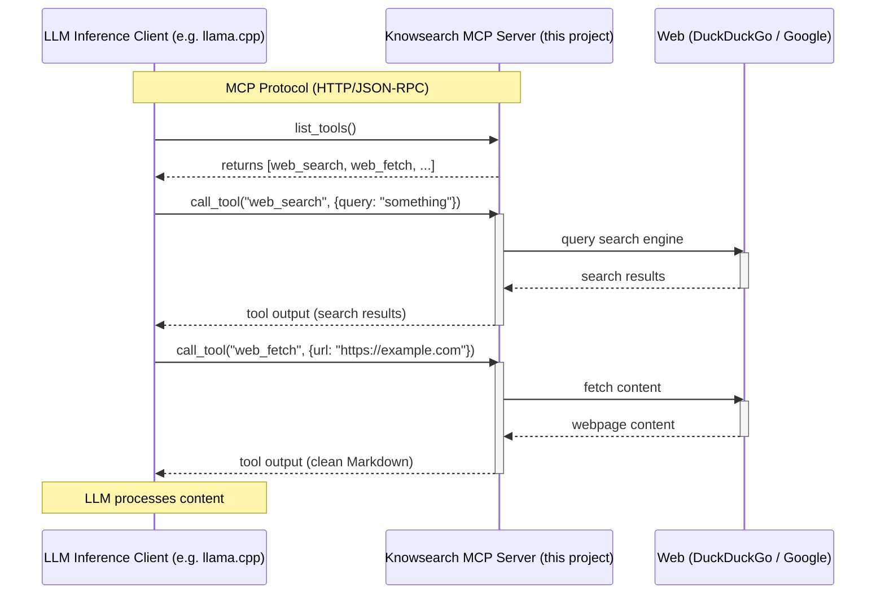

# Knowsearch: Minimal MCP Server



A minimal MCP (Model Context Protocol) server that provides web search and web fetching capabilities.


## Features

- **Web Search**: Search the web using DuckDuckGo or Google and retrieve titles, URLs, and snippets.
- **Web Fetch**: Fetch a webpage and extract its main content as clean Markdown using Trafilatura.


## Installation

Ensure you have Python 3.12+ and `uv` installed.

```bash
uv sync
```


## Running the server

```bash
uv run python main.py
```

The server will be available via HTTP at `http://localhost:8000/mcp`. If running in a container, use `http://<host>:8000/mcp`.


## Running tests

```bash
uv run python -m pytest
```

### Integration Tests
We have integration tests that verify the actual web search and web fetch capabilities:

- `tests/test_integration.py`
    - `test_ddgs_direct_integration`: Verifies that the `ddgs` library performs actual web searches.
    - `test_web_search_ddg_tool_integration`: Verifies the `web_search_ddg` MCP tool correctly integrates with DuckDuckGo.
    - `test_web_search_google_tool_integration`: Verifies the `web_search_google` MCP tool correctly integrates with Google.
    - `test_web_fetch_direct`: Verifies that `web_fetch` can successfully fetch and parse a real webpage.
    - `test_web_fetch_tool_integration`: Verifies the `web_fetch` MCP tool correctly integrates with `trafilatura`.

Run integration tests specifically:
```bash
uv run python -m pytest tests/test_integration.py
```


## Project structure

- `main.py`: Entry point containing the FastMCP server definition and tools.
- `pyproject.toml`: Project configuration and dependencies.
- `tests/`: Test suite.
- `embedder/`: Optional directory for embedding functionality.
- `Dockerfile` & `docker-compose.yml`: Containerization configuration.


## Deployment

To run this server in a production environment, build the Docker image and expose port 8000 so that `llama-server` can call the MCP endpoint at `http://<host>:8000/mcp`.

**Build the image**:
```
docker build -t basic-mcp-server .
```

**Run the container**:
```
docker run -d --name basic-mcp-server -p 8000:8000 basic-mcp-server
```

Alternatively, use `docker-compose`:
```
docker-compose up -d
```

The container will listen on `0.0.0.0:8000` and expose the MCP endpoint at `/mcp`. Verify with:
```
curl http://localhost:8000/mcp
```

Adjust the host in `main.py` if you need a different binding address.


## Configuration

### Local (uv)

```json
{
  "$schema": "https://opencode.ai/config.json",
  "mcp": {
    "servers": {
      "knowsearch": {
        "type": "local",
        "command": ["uv", "run", "python", "main.py", "--host", "0.0.0.0", "--port", "8000"],
        "env": {
          "PYTHONPATH": "."
        }
      }
    }
  }
}
```

### Docker Compose

When running via Docker Compose, use `type: remote` to connect to the mapped port:

```json
{
  "$schema": "https://opencode.ai/config.json",
  "mcp": {
    "servers": {
      "knowsearch": {
        "type": "remote",
        "url": "http://localhost:8000/mcp"
      }
    }
  }
}
```
